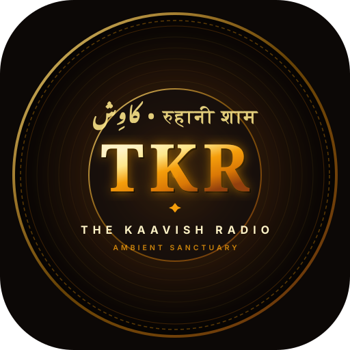

# 📻 The Kaavish Radio (TKR)
### *A Soulful Courtyard of Timeless Harmonies*
#### کاوِش • रुहानी शाम

[](manifest.json)
[](js/ambient-audio.js)
[](server.js)
[](LICENSE)

<br />

<p align="center">
  
</p>

<p align="center">
  <strong>The Kaavish Radio</strong> is an intimate, ad-free ambient musical sanctuary dedicated to the poetry, gentle piano compositions, and semi-classical harmonies of <strong>The Kaavish</strong> (Jaffer Zaidi &amp; Maaz Maudood).
</p>

<p align="center">
  Designed with a warm retro amber glassmorphic aesthetic, it blends timeless melodies with procedural monsoon rain, vintage vinyl crackle, interactive community poetry notes, real-time listener presence, and full Progressive Web App (PWA) support.
</p>

---

## ✨ Features

### 🎵 Curated Discography & Instant Search
- Complete collection of Kaavish masterpieces, including *Faasle*, *Bachpan*, *Nindiya Re*, *Tere Pyaar Mein*, *Choti Si Baat*, *Moray Sayyan*, *Neun La Leya*, and more.
- Real-time search filter allowing listeners to instantly find tracks by title, album, or mood.
- Integrated lyrics drawer featuring poetic transcriptions in Roman Urdu, Hindi, and English.

### 🌧️ Procedural Ambient Sound Mixer
- Powered by native **Web Audio API** synthesis with zero external audio assets.
- Independent, customizable soundscapes:
  - 🌧️ **Baarish (Monsoon Rain)**: Procedurally synthesized pink-noise rain with randomized droplet impacts.
  - 📻 **Vinyl Record Crackle**: Authentic retro turntable static and dust pops.
  - 🦗 **Night Crickets**: Ambient nocturnal insect chorus.
  - ☕ **Warm Saloon Murmur**: Intimate heritage café atmosphere.
- Quick ambient toggles on the hero stage and an advanced multi-channel sound mixer modal.

### 🎨 Atmospheric Scene Themes
- 6 atmospheric visuals tailored for the music:
  - 🎸 *Kaavish Acoustic Sunset Room*
  - ✨ *Stage Spotlight Duo*
  - 🎙️ *Live Concert Stage*
  - 🌧️ *Monsoon Heritage Veranda*
  - 🌅 *Golden Hour Studio*
  - 🌙 *Midnight Rainy Loft*
- Dedicated responsive artwork for desktop (`1920×1080`) and mobile portrait viewports (`1080×1920`).

### 📝 Fan Notes & Community Poetry Board
- A persistent community wall where listeners share thoughts, poetic couplets, and personal memories tied to the music.
- Synchronized in real time via the backend API (`/api/notes`) with optimistic local storage fallback.

### 📻 Mehfil • Real-Time Synchronized Listening (Listen Together)
- **Synchronized Audio Playback**: Enables two or more listeners across the world to tune in together in acoustic harmony.
- **Unique 6-Digit Room Code**: Generate private session codes (e.g. `582914`) or share direct 1-click invite links (`?room=582914`).
- **Sub-Second Latency Compensation**: Automatically adjusts for network transmission latency so both devices play on the exact beat.
- **Collaborative Sync**: Play, pause, timeline seeks, and track selections sync seamlessly across all connected devices in real time via Server-Sent Events (SSE).

### 👥 Real-Time Active Listener Counter
- Live presence tracking via lightweight session heartbeats (`/api/heartbeat`).
- Displays the actual count of concurrent souls currently in the sanctuary across the world.

### 📱 Progressive Web App (PWA) & Offline Resilience
- Fully installable on **Android, iOS, Windows, and macOS**.
- Custom **TKR (The Kaavish Radio)** vector emblem and high-resolution icons (192×192, 512×512, maskable, apple-touch-icon).
- Service Worker (`sw.js`) provides smart pre-caching and instant launch speeds.
- Native 1-click **Download App** button integrated into the hero header.

### 💛 Community Support Modal
- Integrated contribution modal with QR code and UPI ID (`anujjha196@naviaxis`) to help fund server hosting and bandwidth costs to keep the sanctuary ad-free and uninterrupted.

### 🔗 Rich Social Media Previews
- Generates 1200×630 Open Graph and Twitter Card banners (`og-preview.png`).
- Smart Web Share API integration that shares formatted invitation messages along with the official TKR logo.

---

## 🛠️ Tech Stack

- **Frontend Core**: Vanilla HTML5 (Semantic), Vanilla Modern JavaScript (ES6+ Modules)
- **Styling**: Vanilla CSS3 (Custom Design System, Glassmorphism, CSS Grid, Flexbox, Micro-animations)
- **Audio Engine**: HTML5 YouTube IFrame Player API + Native Web Audio API Synthesizers
- **Visual Effects**: HTML5 2D Canvas Procedural Rain Animation Engine
- **Backend**: Lightweight Node.js Native HTTP Server (zero bloated framework dependencies)
- **PWA**: Web App Manifest (`manifest.json`) + Service Worker (`sw.js`)

---

## 📂 Project Structure

```text
The-Kaavish-Radio/
├── assets/
│   ├── icons/                  # PWA and Favicon assets
│   │   ├── logo-tkr.svg        # Master vector brand emblem
│   │   ├── icon-192.png        # 192x192 HD home-screen icon
│   │   ├── icon-512.png        # 512x512 HD app icon
│   │   ├── apple-touch-icon.png# iOS touch icon
│   │   └── og-preview.png      # 1200x630 Social share banner
│   └── images/                 # Theme artwork & backgrounds
│       ├── Img1.png / Img1_mob.png
│       ├── Img2.png / Img2_mob.png
│       ├── Img3.png / Img3_mob.png
│       ├── theme_courtyard.jpg
│       ├── theme_midnight.jpg
│       ├── theme_sunset.jpg
│       └── support_qr.jpeg     # Contribution QR code
├── css/
│   └── style.css               # Comprehensive theme & design system
├── data/
│   └── notes.json              # Persisted fan notes and community messages
├── js/
│   ├── ambient-audio.js        # Web Audio API ambient noise synthesizers
│   ├── rain-effect.js          # Procedural 2D canvas rain physics
│   ├── player.js               # Kaavish playlist & YouTube audio engine
│   └── app.js                  # Main app controller, PWA logic & UI handlers
├── index.html                  # Single-page web application entry point
├── manifest.json               # Web App Manifest for PWA installation
├── sw.js                       # Service Worker for offline asset caching
├── server.js                   # Node.js HTTP server & REST APIs
└── package.json                # Project manifest and scripts
```

---

## 🚀 Getting Started

### Prerequisites
- [Node.js](https://nodejs.org/) (Version 18.0.0 or higher)

### 1. Clone the Repository
```bash
git clone https://github.com/its-jhaanuj-21/The-Kaavish-Radio.git
cd The-Kaavish-Radio
```

### 2. Start the Local Server
```bash
npm start
# or
node server.js
```

### 3. Open in Browser
- **Desktop**: Visit [http://localhost:8080/](http://localhost:8080/)
- **Mobile Device**: Connect your mobile phone to the same Wi-Fi network and navigate to:
  ```text
  http://<YOUR_LOCAL_IP>:8080/
  ```

---

## 📲 How to Install as an App (PWA)

### Android (Chrome / Samsung Internet)
1. Open the website on your phone.
2. Tap the **"Download App (TKR)"** button in the hero section (or tap `⋮` > **"Install app"**).
3. The app will install directly to your app drawer and home screen.

### iOS (Safari)
1. Open the website in Safari.
2. Tap the **Share** button (box with an arrow pointing up `⎋`).
3. Scroll down and tap **"Add to Home Screen"**.

### Desktop (Chrome / Edge / Brave)
1. Open the site in your browser.
2. Click the **Install** icon on the right side of the URL address bar or click **"Download App"**.
3. TKR will launch in its own standalone, distraction-free desktop window.

---

## 🎼 Dedication & Musical Credits

This project is created out of deep reverence for **The Kaavish**:
- **Jaffer Zaidi** — Vocals, Compositions, Piano & Harmonies
- **Maaz Maudood** — Guitars, Backing Vocals & Arrangements

*All music copyrights belong to their respective original artists, producers, and labels (including Coke Studio Pakistan and EMI Pakistan).*

---

## 👨‍💻 Creator & Maintainer

Crafted with ♥ by **Anuj Jha**
- **Instagram**: [@heyitsmeanuj21](https://instagram.com/heyitsmeanuj21)
- **GitHub**: [@its-jhaanuj-21](https://github.com/its-jhaanuj-21)

---

## 📄 License

This project is open-source under the [MIT License](LICENSE).
Feel free to study, contribute, and build upon this musical sanctuary.
